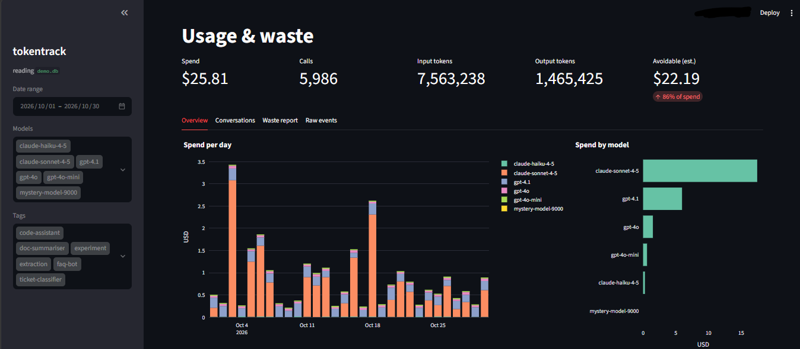

# tokentrack

**Find out where your AI money is going — and how much of it is wasted.**



If your program calls an AI model (OpenAI, Anthropic/Claude, Groq, Gemini, Ollama, and others),
tokentrack quietly writes down every call: which model, how many tokens, what it cost.
Then it looks at the pile and tells you, in plain English, things like:

- *"3,000 short calls ran on GPT-4o but would work on GPT-4o-mini — about $140/month cheaper."*
- *"40 chats re-sent the whole conversation every turn. Starting fresh every few turns would have saved $9."*
- *"Your FAQ bot's answers are 5× longer than the questions. Ask it to be brief."*

Everything stays on your computer. Nothing is uploaded anywhere.

---

## Who this is for

Anyone whose code talks to an AI model and who has ever looked at the bill and thought
*"where did that go?"* You don't need to understand tokens to use it. You do need to be
able to run a Python program.

## What you need

- Python 3.10 or newer ([download](https://www.python.org/downloads/) — on Windows, tick "Add Python to PATH" during install)
- An API key for at least one AI provider. **Groq gives free keys with no card**
  at [console.groq.com](https://console.groq.com) — good for trying this out.

## Install (5 minutes)

Open a terminal (Windows: search for "Git Bash" or "PowerShell"; Mac: "Terminal").
Type each line and press Enter.

```bash
# 1. Download the project and go into its folder
git clone https://github.com/YOUR-USERNAME/tokentrack.git
cd tokentrack

# 2. Make a private Python space for it (so it can't mess with anything else)
python -m venv .venv

# 3. Switch into that space. Pick the line for your system:
source .venv/bin/activate          # Mac / Linux / Git Bash on Windows
.venv\Scripts\activate             # Windows PowerShell or Command Prompt

# 4. Install what it needs
pip install -e . openai anthropic pandas streamlit plotly

# 5. Check it works (no API key needed, costs nothing)
python test_offline.py
```

If the last line prints **All checks passed**, you're set.

> Every time you open a new terminal, redo step 3 before running anything.

## See it work with fake data (1 minute)

Don't have usage yet? Generate a fake month for an imaginary team and look at it:

```bash
python coach.py --demo
streamlit run dashboard.py -- --db demo.db
```

A browser tab opens. Click **Waste report**. That's the whole point of the tool, on sample data.
Press `Ctrl+C` in the terminal to stop it.

## Use it on real calls

**Step 1 — tell the terminal your API key.** Replace the dots with your real key.
Nothing prints back; that's normal.

```bash
export GROQ_API_KEY=gsk_...         # Mac / Linux / Git Bash
$env:GROQ_API_KEY="gsk_..."         # Windows PowerShell
set GROQ_API_KEY=gsk_...            # Windows Command Prompt
```

(For OpenAI it's `OPENAI_API_KEY`, for Anthropic `ANTHROPIC_API_KEY`.)

**Step 2 — run an example.** This one deliberately does wasteful things so there's
something to find:

```bash
python examples/groq_wasteful_app.py
```

**Step 3 — look at the results.**

```bash
python coach.py                     # findings, printed in the terminal
streamlit run dashboard.py          # the same, as a web page with charts
```

## Put it in your own program

Find the line where your code creates the AI client. Wrap it. That's the only change.

```python
import tokentrack
from openai import OpenAI

client = tokentrack.wrap(OpenAI())          # was:  client = OpenAI()
```

Works the same for Anthropic (`tokentrack.wrap(Anthropic())`) and for any provider you
reach through the OpenAI client with a different `base_url` (Groq, Gemini, Ollama, OpenRouter…).

Two optional extras make the findings sharper:

```python
conv = tokentrack.new_conversation()                       # once per chat
client.chat.completions.create(..., conversation_id=conv,   # groups the turns of one chat
                               tag="support-bot")           # labels which part of your app this is
```

Every call now lands in `tokentrack.db` in the folder you ran from. Run `python coach.py`
or `streamlit run dashboard.py` whenever you want to look.

## What it checks for

| Finding | What it means | What to do |
|---|---|---|
| **Context bloat** | A chat re-sends its whole history every turn, so each message costs more than the last | Start a fresh chat, or summarise, every few turns |
| **Model mismatch** | Tiny jobs (one-word answers, classification) running on an expensive model | Try the cheaper sibling on a sample and compare |
| **Verbose output** | Answers far longer than the questions. Output tokens cost 4–8× input tokens | Add "answer in two sentences" or set `max_tokens` |
| **No caching** | The same long prompt sent over and over at full price | Turn on prompt caching (OpenAI and Anthropic discount repeats by 50–90%) |
| **Unpriced models** | A model missing from the price table, so its cost shows as blank | Add a line to `tokentrack/pricing.py` |

The dollar figures are **estimates**, built on assumptions that are written in plain sight
in `coach.py` (for example, "assume 70% of a large prompt is cacheable"). Treat them as
"roughly this much," not an invoice.

## Privacy

By default tokentrack stores **only numbers** — token counts, model names, timestamps.
It never stores what you asked or what the model answered unless you explicitly turn that on
with `tokentrack.wrap(client, store_text=True)`. The database is a single file on your disk.
No account, no server, no upload.

## Prices

`tokentrack/pricing.py` is a plain list of dollars per million tokens. Providers change
prices and rename models often, so check it against their pricing pages now and then.
Groq's free tier shows as its paid list price so you can see what the same usage *would* cost.

## Honest status

- Tested live on Groq. OpenAI and Anthropic are tested with mocked responses that match
  the real response shape — if something breaks, please open an issue with the error.
- Streaming works (OpenAI needs `stream_options={"include_usage": True}`).
- Not yet: async clients (`AsyncOpenAI`, `AsyncAnthropic`), the Google Gemini SDK directly
  (use Gemini through the OpenAI client for now), team/multi-user mode.

## Files, if you're curious

```
tokentrack/        the library — pricing.py (price table), storage.py (writes the db), __init__.py (the wrapper)
coach.py           the rules that find waste; also makes the demo data
dashboard.py       the web page (Streamlit)
report.py          a quick terminal summary
examples/          small scripts you can run as-is
test_offline.py    proves the wrapper works without an API key
```

## Problems?

- **`No module named 'tokentrack'`** — you skipped `pip install -e .`, or you're in the wrong folder. `cd` to the folder with `coach.py` in it.
- **`GROQ_API_KEY is not set`** — redo the `export` line in this terminal window.
- **`model does not exist`** — the provider retired that model name. Pick a current one from their docs and change the `model=` line in the example.
- **Dashboard shows "No data yet"** — run an example first, or use `--db demo.db`.

Anything else: open an issue and paste the full error.